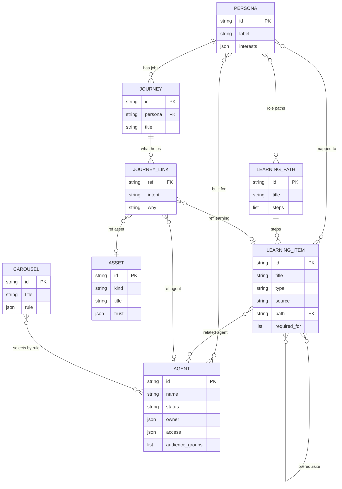
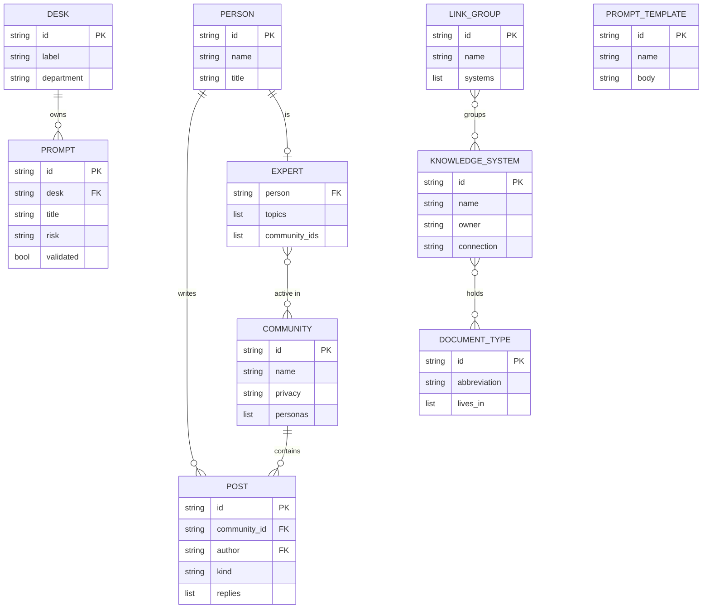

# Data model

Nexus keeps its data in two places:

- **Catalogue content** in JSON files under `backend/data/`. Read-only at run time: agents, learning, "Your work", community, prompts and knowledge sources.
- **What people do** in SQLite at `backend/var/hub.db` (`backend/app/database.py`): sign-ins, progress, ratings, feedback, requests and Super Agent conversations.

The two are joined only by ids. SQLite stores `item_id`, `agent_id`, `prompt_id` and `post_id` as plain text that names a record in a JSON file. Nothing enforces those links.

The diagrams show the key fields of each entity, not every field.

## 1. Core catalogue (JSON)

Agents, learning and "Your work", tied together by persona.

| Entity | File |
| --- | --- |
| Persona | `personas.json` |
| Agent | `agents.json` |
| Learning item, learning path | `learning.json` (`items`, `paths`, `persona_paths`) |
| Journey, journey link | `journeys.json` |
| Asset | `assets.json` |
| Carousel | `carousels.json` |

Notes:

- A journey link holds one reference. Its prefix says what it points at: `agent:`, `learning:` or `asset:`.
- A carousel holds a rule, not a list. Which agents appear is worked out from the rule on each request.

## 2. Community, prompts and knowledge sources (JSON)

| Entity | File |
| --- | --- |
| Community, post, person, expert | `community.json` |
| Prompt, desk, prompt template | `prompts.json` |
| Knowledge system, document type, link group | `knowledge-sources.json` |

## 3. User activity (SQLite)

Every table belongs to a user.

```mermaid
erDiagram
  USERS ||--o{ SESSIONS : "signs in"
  USERS ||--o| PREFERENCES : "has"
  USERS ||--o{ NOTIFICATION_READS : "reads"
  USERS ||--o{ LEARNING_PROGRESS : "tracks"
  USERS ||--o{ LEARNING_RATINGS : "rates"
  USERS ||--o{ EVENTS : "generates"
  USERS ||--o{ FEEDBACK : "gives"
  USERS ||--o{ ACCESS_REQUESTS : "requests"
  USERS ||--o{ SAVED_PROMPTS : "saves"
  USERS ||--o{ CONTRIBUTIONS : "submits"
  USERS ||--o{ HUB_SESSIONS : "asks"
  USERS ||--o{ COMMUNITY_REPLIES : "replies"
  USERS ||--o{ COMMUNITY_LIKES : "likes"
  USERS {
    text id PK
    text email UK
    text password_hash
    text profile
    int active
  }
  SESSIONS {
    text token_hash PK
    text user_id FK
    real expires_at
  }
  PREFERENCES {
    text user_id PK
    text value
  }
  NOTIFICATION_READS {
    text user_id PK
    text notification_id PK
  }
  LEARNING_PROGRESS {
    text user_id PK
    text item_id PK
    text status
    int progress
  }
  LEARNING_RATINGS {
    text user_id PK
    text item_id PK
    int stars
  }
  EVENTS {
    text id PK
    text user_id FK
    text at
    text payload
  }
  FEEDBACK {
    text id PK
    text user_id FK
    text payload
  }
  ACCESS_REQUESTS {
    text id PK
    text user_id FK
    text agent_id
    text status
  }
  SAVED_PROMPTS {
    text user_id PK
    text prompt_id PK
    text saved_at
  }
  CONTRIBUTIONS {
    text id PK
    text user_id FK
    text kind
    text status
    text audience
  }
  HUB_SESSIONS {
    text id PK
    text session_id
    text user_id FK
    text selected_pillars
    text feedback
  }
  COMMUNITY_REPLIES {
    text id PK
    text thread_id
    text user_id FK
    text body
  }
  COMMUNITY_LIKES {
    text user_id PK
    text post_id PK
  }
```

Where a table points into the catalogue:

| Table | Column | Names a record in |
| --- | --- | --- |
| `learning_progress`, `learning_ratings` | `item_id` | `learning.json` items |
| `access_requests` | `agent_id` | `agents.json` |
| `saved_prompts` | `prompt_id` | `prompts.json` |
| `community_replies` | `thread_id` | `community.json` posts |
| `community_likes` | `post_id` | `community.json` posts |
| `hub_sessions` | `recommended_asset_ids`, `selected_asset_ids` | agents, learning items and assets |

Notes:

- `hub_sessions` holds one row per question the Super Agent answered: ids and measures only, never the question text.
- `events` and `feedback` keep their detail as JSON in `payload`.
- `users.profile` is the directory profile as JSON. The persona is not stored: it is worked out from the job title and department with `persona-mapping.json`.

## Not drawn

- `policy.json`: what the model may be sent, by data sensitivity. One record.
- `user.json`: the mocked directory profile for the prototype. One record.
- `agent-metadata-template.json`: the template for registering an agent.
- `migrations` and `login_attempts`: housekeeping tables that relate to nothing else.
