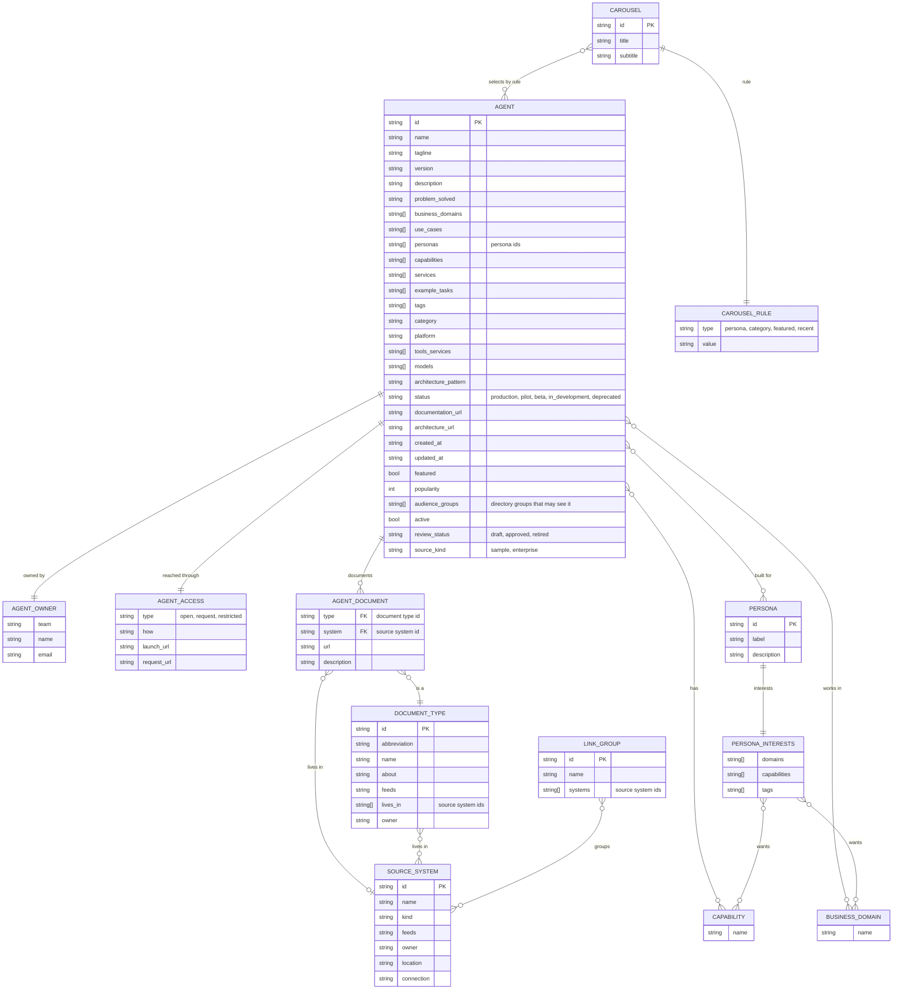
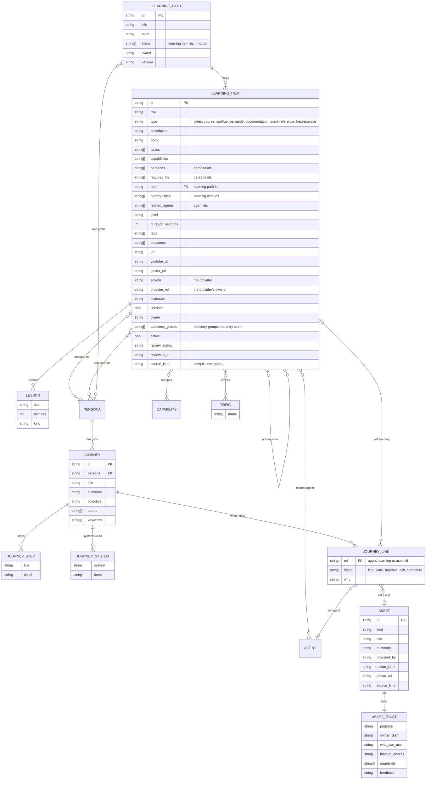
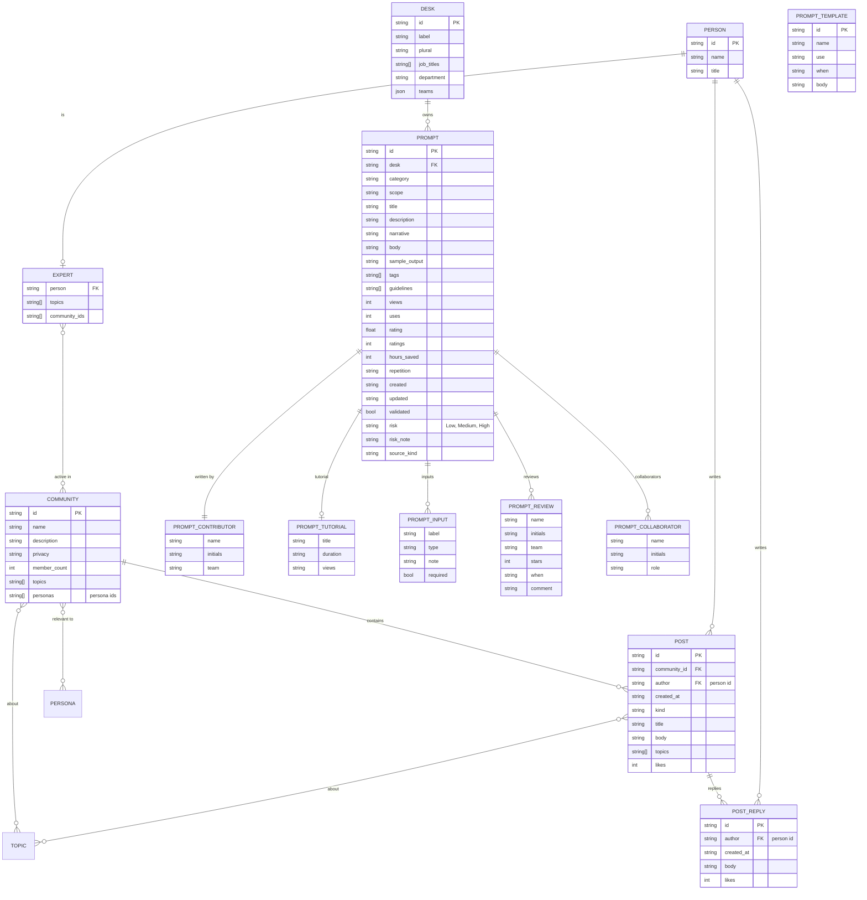

# Data model

Nexus keeps its data in two places:

- **Catalogue content** in JSON files under `backend/data/`. Read-only at run time: agents, learning, "Your work", community, prompts and the list of source systems.
- **What people do** in SQLite at `backend/var/hub.db` (`backend/app/database.py`): sign-ins, progress, ratings, feedback, requests and Super Agent conversations.

The two are joined only by ids. SQLite stores `item_id`, `agent_id`, `prompt_id` and `post_id` as plain text that names a record in a JSON file. Nothing enforces those links.

The diagrams show every field. How to read them:

- `string[]` is a list of values held on the record itself.
- An entity drawn with no fields is defined in another diagram.
- Entities marked *(embedded)* below are objects stored inside their parent record, not records of their own.
- `CAPABILITY`, `BUSINESS_DOMAIN` and `TOPIC` are shared words, not files: the same strings appear on agents, learning items and personas, and matching on them is how the three are related.

## 1. Agents and discovery (JSON)

| Entity | File |
| --- | --- |
| Agent, with its owner, access and documents *(embedded)* | `agents.json` |
| Persona, with its interests *(embedded)* | `personas.json` |
| Carousel, with its rule *(embedded)* | `carousels.json` |
| Source system, document type, link group | `knowledge-sources.json` (`systems`, `document_types`, `link_groups`) |

Notes:

- A source system is an MUFG system where an agent's documents and records live: Confluence, SharePoint, JIRA, ServiceNow. It is a reference list, not a knowledge base or a search index. Nexus links to documents where they live and keeps no copies. The file is still named `knowledge-sources.json`.
- A carousel holds a rule, not a list. Which agents appear is worked out from the rule on each request.
- `services`, `example_tasks` and `documents` are part of the agent model but no sample agent fills them yet.
- A user is given a persona from their job title and department by `persona-mapping.json`. That mapping is rules, not a stored link.

## 2. Learning and "Your work" (JSON)

| Entity | File |
| --- | --- |
| Learning item, with its lessons *(embedded)* | `learning.json` (`items`) |
| Learning path | `learning.json` (`paths`) |
| Persona to learning paths | `learning.json` (`persona_paths`) |
| Journey, with its steps, systems and links *(embedded)* | `journeys.json`, grouped by persona |
| Asset, with its trust details *(embedded)* | `assets.json` |

Notes:

- A journey link holds one reference. Its prefix says what it points at: `agent:`, `learning:` or `asset:`.
- A learning item belongs to one path (`path`), and a path lists its items in order (`steps`).

## 3. Community and prompts (JSON)

| Entity | File |
| --- | --- |
| Community, person, expert | `community.json` |
| Post, with its replies *(embedded)* | `community.json` (`posts`) |
| Prompt, with its contributor, tutorial, inputs, reviews and collaborators *(embedded)* | `prompts.json` (`prompts`) |
| Desk, prompt template | `prompts.json` (`desks`, `templates`) |

## 4. User activity (SQLite)

Every table but the last two belongs to a user.

```mermaid
erDiagram
  USERS ||--o{ SESSIONS : "signs in"
  USERS ||--o| PREFERENCES : "has"
  USERS ||--o{ NOTIFICATION_READS : "reads"
  USERS ||--o{ LEARNING_PROGRESS : "tracks"
  USERS ||--o{ LEARNING_RATINGS : "rates"
  USERS ||--o{ EVENTS : "generates"
  USERS ||--o{ FEEDBACK : "gives"
  USERS ||--o{ ACCESS_REQUESTS : "requests"
  USERS ||--o{ SAVED_PROMPTS : "saves"
  USERS ||--o{ CONTRIBUTIONS : "submits"
  USERS ||--o{ HUB_SESSIONS : "asks"
  USERS ||--o{ COMMUNITY_REPLIES : "replies"
  USERS ||--o{ COMMUNITY_LIKES : "likes"
  USERS {
    text id PK
    text email UK
    text password_hash
    text profile "directory profile, JSON"
    int active
  }
  SESSIONS {
    text token_hash PK
    text user_id FK
    real expires_at
  }
  PREFERENCES {
    text user_id PK, FK
    text value "JSON"
  }
  NOTIFICATION_READS {
    text user_id PK, FK
    text notification_id PK
  }
  LEARNING_PROGRESS {
    text user_id PK
    text item_id PK "learning item id"
    text status "not_started, in_progress, completed"
    int progress "0 to 100"
    text started_at
    text completed_at
    text updated_at
  }
  LEARNING_RATINGS {
    text user_id PK, FK
    text item_id PK "learning item id"
    int stars "1 to 5"
    text created_at
    text updated_at
  }
  EVENTS {
    text id PK
    text user_id
    text at
    text payload "JSON"
    text event_key UK
  }
  FEEDBACK {
    text id PK
    text user_id
    text at
    text payload "JSON"
  }
  ACCESS_REQUESTS {
    text id PK
    text user_id FK
    text agent_id "agent id"
    text reason
    text status "pending by default"
    text created_at
  }
  SAVED_PROMPTS {
    text user_id PK, FK
    text prompt_id PK "prompt id"
    text saved_at
  }
  CONTRIBUTIONS {
    text id PK
    text user_id FK
    text kind "prompt, video, agent"
    text status "in_review, live, returned"
    text title
    text payload "JSON"
    text created_at
    text desk
    text department
    text audience "team, department, everyone"
  }
  HUB_SESSIONS {
    text id PK
    text session_id
    text user_id FK
    text intents "JSON list"
    text activity
    text selected_pillars "JSON list"
    text recommended_asset_ids "JSON list"
    text selected_asset_ids "JSON list"
    text feedback "helpful, not_helpful"
    text sensitivity
    text plan_source
    text reply_source
    int latency_ms
    text created_at
  }
  COMMUNITY_REPLIES {
    text id PK
    text thread_id "post id"
    text user_id FK
    text body
    text created_at
  }
  COMMUNITY_LIKES {
    text user_id PK, FK
    text post_id PK "post id"
    text created_at
  }
  LOGIN_ATTEMPTS {
    text address PK
    int failures
    real until_at
  }
  MIGRATIONS {
    text name PK
  }
```

Where a table points into the catalogue:

| Table | Column | Names a record in |
| --- | --- | --- |
| `learning_progress`, `learning_ratings` | `item_id` | `learning.json` items |
| `access_requests` | `agent_id` | `agents.json` |
| `saved_prompts` | `prompt_id` | `prompts.json` |
| `community_replies` | `thread_id` | `community.json` posts |
| `community_likes` | `post_id` | `community.json` posts |
| `hub_sessions` | `recommended_asset_ids`, `selected_asset_ids` | agents, learning items and assets |

Notes:

- `hub_sessions` holds one row per question the Super Agent answered: ids and measures only, never the question text.
- `events` and `feedback` keep their detail as JSON in `payload`.
- `users.profile` is the directory profile as JSON. The persona is not stored: it is worked out from the job title and department with `persona-mapping.json`.
- One request per user per agent: `access_requests` is unique on `user_id` and `agent_id`.

## Not drawn

- `policy.json`: what the model may be sent, by data sensitivity. One record.
- `user.json`: the mocked directory profile for the prototype. One record.
- `persona-mapping.json`: the rules that give a user a persona.
- `agent-metadata-template.json`: the template for registering an agent.
